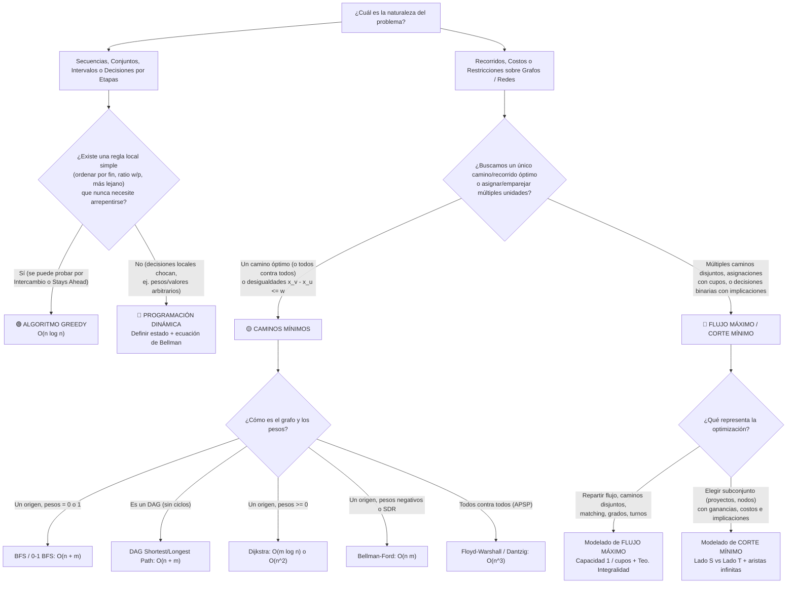

# Guía Maestra del Segundo Parcial — Algoritmos 3 (TDA) Exactas UBA

> **Materia:** Algoritmos y Estructuras de Datos III / Técnicas de Diseño de Algoritmos (Exactas - UBA)  
> **Contenido:** Integración ejecutiva de los 4 bloques del Segundo Parcial: **Programación Dinámica (PD)**, **Algoritmos Greedy**, **Caminos Mínimos (SSSP / APSP)** y **Flujo Máximo / Corte Mínimo**.

---

## Índice

1. [Mapa de Navegación de los 4 Resúmenes](#1-mapa-de-navegación-de-los-4-resúmenes)
2. [Árbol de Decisión: ¿Con qué técnica ataco un problema de parcial?](#2-árbol-de-decisión-con-qué-técnica-ataco-un-problema-de-parcial)
3. [Tabla Comparativa General de Algoritmos y Complejidades](#3-tabla-comparativa-general-de-algoritmos-y-complejidades)
4. [Plantillas de Demostración para el Parcial (Paso a Paso)](#4-plantillas-de-demostración-para-el-parcial-paso-a-paso)
   - [4.1 Plantilla de Programación Dinámica](#41-plantilla-de-programación-dinámica)
   - [4.2 Plantilla de Algoritmos Greedy](#42-plantilla-de-algoritmos-greedy)
   - [4.3 Plantilla de Modelado de Caminos Mínimos](#43-plantilla-de-modelado-de-caminos-mínimos)
   - [4.4 Plantilla de Modelado con Flujo Máximo / Corte Mínimo](#44-plantilla-de-modelado-con-flujo-máximo--corte-mínimo)
5. [Trampas Clásicas de Examen y Verdadero/Falso Frecuentes](#5-trampas-clásicas-de-examen-y-verdaderofalso-frecuentes)
6. [Conexiones con los Talleres de Codeforces de la Materia](#6-conexiones-con-los-talleres-de-codeforces-de-la-materia)

---

## 1. Mapa de Navegación de los 4 Resúmenes

Esta carpeta (`06_Resumenes_Segundo_Parcial`) contiene el desarrollo exhaustivo de cada unidad:

1. **[01_Resumen_Programacion_Dinamica.md](./01_Resumen_Programacion_Dinamica.md):**
   - Principio de Optimalidad de Bellman, Subestructura Óptima y Superposición de Subproblemas.
   - Top-Down (Memoización) vs. Bottom-Up (Tabulación), optimización espacial y reconstrucción de soluciones sin aumentar la complejidad espacial.
   - **Catálogo completo:** Fibonacci, Cambio de Monedas, Mochila 0-1, Subset Sum, Cortar la Vara, Escaleras, Caminitos en Grilla, LCS, Edit Distance, LIS, Multiplicación de Matrices en Cadena (Catalan), Árboles Binarios de Búsqueda Óptimos (OBST), Vacaciones, Gasoducto, Viaje (Bitmask DP / TSP), Pila de Cajas, Casetes, Travesía Vital, Operaciones con Secuencia, Compra-Venta de Acciones y Poda de Árboles.
2. **[02_Resumen_Algoritmos_Greedy.md](./02_Resumen_Algoritmos_Greedy.md):**
   - Propiedad de Elección Greedy y Subestructura Óptima.
   - Las 3 técnicas de demostración: *Greedy stays ahead* (Inducción), *Argumento de Intercambio* (Exchange Argument) y *Reducción a un problema conocido*.
   - **Catálogo completo:** Selección de Actividades, Scheduling para Minimizar Latencia Máxima (Inversión), Minimizar Suma Ponderada de Tiempos de Finalización ($w_i / p_i$), Alquiler de Canchas (Coloración de Intervalos), Mochila Fraccionaria vs 0-1, Cambio de Monedas, **Códigos de Huffman** (con lemas de optimalidad), Suma Golosa, Parejas de Baile, Ruta Eficiente, **Caché Óptimo de Belady (Farthest-in-Future)**, Suma Mínima, Subsecuencia Creciente, Caballos de Troya y Libros en Cajas.
3. **[03_Resumen_Caminos_Minimos.md](./03_Resumen_Caminos_Minimos.md):**
   - Existencia de caminos mínimos ($\iff$ sin ciclos negativos alcanzables y que alcancen el destino), propiedades de relajación $\text{Relax}(u, v, w)$ y grafo de predecesores $G_\pi$.
   - **SSSP:** BFS ($w=1$), **Camino Mínimo en DAG** ($O(n+m)$, permite pesos negativos), **Dijkstra** ($O(m \log n)$ o $O(n^2)$, falla con aristas negativas), **Bellman-Ford** ($O(nm)$, detecta y reconstruye ciclos negativos).
   - **Sistemas de Diferencias de Restricciones (SDR):** $x_v - x_u \le w \iff \text{arista } (u, v)$ de peso $w$; factible $\iff$ sin ciclos negativos; maximizar $\sum (x_i - \min x)$ y minimizar $\max x - \min x$.
   - **APSP:** **Floyd-Warshall** ($O(n^3)$, programación dinámica sobre vértices intermedios $\{1..k\}$, detección de ciclos negativos en la diagonal $D_{ii} < 0$) y **Algoritmo de Dantzig** ($O(n^3)$, inductivo agregando el vértice $k$, invariante por entrada y salida).
   - **Técnicas de Modelado:** Reversión de aristas, multiplicación de vértices / grafo de estados (tanque de nafta, $k$ aristas gratis/duplicadas), caminos críticos en DAG, arbitraje de divisas ($-\log R$), cuellos de botella (Min-Max / Max-Min) y reconstrucción a partir de matrices de distancias.
4. **[04_Resumen_Flujo_Maximo.md](./04_Resumen_Flujo_Maximo.md):**
   - Red de flujo $(G, s, t, c)$, conservación de flujo, supuestos simplificadores, Red Residual $G_f$, caminos de aumento y Método de Ford-Fulkerson ($O(mF)$).
   - Cortes $s$-$t$, Lema del Flujo a través de un Corte ($\text{val}(f) = f(S, T) - f(T, S) \le c(S, T)$), **Teorema de Flujo Máximo / Corte Mínimo** y **Teorema de Integralidad**.
   - **Algoritmo de Edmonds-Karp:** Búsqueda por BFS, lema de monotonía de distancias, aristas críticas y cota $O(\min(m|f^*|, nm^2))$.
   - **Catálogo de Modelado:** Caminos disjuntos en aristas y en vértices (*Vertex Splitting*, Menger), Matching Bipartito, Familias y Mesas, Hospitales (capa intermedia médico $\times$ período), Matrices y Digrafos con grados dados, Eulerización de grafos mixtos, Cena de zorros, Selección de Proyectos (Clausura de peso máximo), Edificios con restricciones (cadenas con $\infty$), Vertex Cover y Conjunto Independiente de Peso Máximo en grafos bipartitos.

---

## 2. Árbol de Decisión: ¿Con qué técnica ataco un problema de parcial?

---

## 3. Tabla Comparativa General de Algoritmos y Complejidades

| Bloque | Algoritmo / Problema | Condición de Aplicabilidad | Complejidad Temporal | Complejidad Espacial | Observación Clave de Examen |
| :--- | :--- | :--- | :--- | :--- | :--- |
| **PD** | Mochila 0-1 / Subset Sum | Pesos enteros $W$ | $O(n \cdot W)$ | $O(nW)$ o $O(W)$ | **Pseudo-polinomial** (exponencial en $\log W$). |
| **PD** | LCS / Edit Distance | Dos secuencias de largos $n, m$ | $O(n \cdot m)$ | $O(nm)$ o $O(\min(n,m))$ | Reconstruir con espacio $O(m)$ requiere D&C (Hirschberg). |
| **PD** | LIS (Subsecuencia Creciente) | Secuencia de largo $n$ | $O(n^2)$ (PD) / $O(n \log n)$ (BS) | $O(n)$ | Estado: $dp[i] =$ LIS que **termina exactamente en $i$**. |
| **PD** | Multiplicación de Matrices / OBST | PD sobre intervalos $[i..j]$ | $O(n^3)$ | $O(n^2)$ | Iterar Bottom-Up por **longitud de intervalo** $L = 1 \dots n$. |
| **PD** | TSP / Viaje (Bitmask DP) | Grafo pequeño ($n \le 20$) | $O(n^2 \cdot 2^n)$ | $O(n \cdot 2^n)$ | Estado $(v, S)$ con $S \subseteq V$ máscara de bits. |
| **Greedy** | Selección de Actividades | Intervalos $[s_i, f_i)$ | $O(n \log n)$ | $O(n)$ | Ordenar por **tiempo de finalización $f_i$ creciente**. |
| **Greedy** | Minimizar Latencia Máxima | Tareas con duración $t_i$ y entrega $d_i$ | $O(n \log n)$ | $O(n)$ | **EDD:** Ordenar por **deadline $d_i$ creciente** (Intercambio). |
| **Greedy** | Códigos de Huffman | Frecuencias $f_1 \dots f_n$ | $O(n \log n)$ | $O(n)$ | Min-Heap fusionando los **2 símbolos menos frecuentes**. |
| **Greedy** | Caché Óptimo (Belady) | Secuencia de $m$ pedidos, caché $k$ | $O(m \log k)$ | $O(m)$ | Desalojar el elemento cuyo próximo uso esté **más lejos en el futuro**. |
| **Cam. Mín.** | Camino Mínimo/Crítico en DAG | Digrafo **acíclico** (pesos $\in \mathbb{R}$) | $O(n + m)$ | $O(n)$ | Relajar en **orden topológico**. Permite hallar camino **más largo**. |
| **Cam. Mín.** | Dijkstra | Pesos **no negativos** ($w(e) \ge 0$) | $O(m \log n)$ o $O(n^2)$ | $O(n)$ | En grafos densos ($m \approx n^2$) usar implementación sin heap $O(n^2)$. |
| **Cam. Mín.** | Bellman-Ford | Pesos arbitrarios ($w(e) \in \mathbb{R}$) | $O(n \cdot m)$ | $O(n)$ | $n-1$ pasadas de relajación; la pasada $n$-ésima detecta ciclos negativos. |
| **Cam. Mín.** | Sistema Dif. Restricciones (SDR) | Desigualdades $x_v - x_u \le w_{uv}$ | $O(n \cdot m)$ | $O(n + m)$ | Arista $(u, v)$ de peso $w_{uv}$ + super-fuente $s$ con $w(s, v)=0$. |
| **Cam. Mín.** | Floyd-Warshall | APSP, pesos arbitrarios | $O(n^3)$ | $O(n^2)$ | $d^{(k)}_{ij} = \min(d^{(k-1)}_{ij}, d^{(k-1)}_{ik} + d^{(k-1)}_{kj})$. |
| **Cam. Mín.** | Algoritmo de Dantzig | APSP, pesos arbitrarios | $O(n^3)$ | $O(n^2)$ | Agrega el vértice $k$ al subgrafo inducido por $\{1..k-1\}$. |
| **Flujo** | Método de Ford-Fulkerson | Capacidades enteras | $O(m \cdot |f^*|)$ | $O(n + m)$ | Pseudo-polinomial; con capacidades irracionales puede no terminar. |
| **Flujo** | Algoritmo de Edmonds-Karp | Camino de aumento más corto (BFS) | $O(\min(m|f^*|, \, n m^2))$ | $O(n + m)$ | Cada arista es crítica $\le n/2$ veces $\implies O(nm)$ aumentos. |

---

## 4. Plantillas de Demostración para el Parcial (Paso a Paso)

### 4.1 Plantilla de Programación Dinámica
1. **Definición semántica de la función recursiva:** *"Sea $f(i, c)$ el valor óptimo (máximo/mínimo) considerando el prefijo/sufijo $1 \dots i$ con capacidad restante $c$"*.
2. **Ecuación de recurrencia y casos base:** Distinguir claramente los dominios de cada rama y los valores de retorno para casos válidos ($0$) vs. inválidos ($\pm \infty$).
3. **Justificación de la Subestructura Óptima:** Mostrar por qué una decisión óptima en el estado actual se compone necesariamente de soluciones óptimas de los subproblemas invocados.
4. **Espacio de estados y superposición:** Contar cuántos estados distintos existen ($|S|$) y cuánto cuesta calcular la transición de un estado asumiendo los anteriores ya calculados ($T_{\text{trans}}$).
5. **Complejidad:** Tiempo $= O(|S| \cdot T_{\text{trans}})$, Espacio $= O(|S|)$.

### 4.2 Plantilla de Algoritmos Greedy
- **Opción A — Argumento de Intercambio (*Exchange Argument*, ideal para problemas de ordenamiento/scheduling):**
  1. Sea $G$ la solución golosa y sea $O$ una solución óptima que **difiere lo menos posible** de $G$ (o tiene la mínima cantidad de inversiones respecto al orden greedy).
  2. Si $O \neq G$, existe un primer punto de desacuerdo (o un par de elementos adyacentes invertidos $(i, j)$ en $O$ donde Greedy ordena $i$ antes que $j$, es decir $c(i) \le c(j)$, pero en $O$ aparece $j$ inmediatamente antes que $i$).
  3. Definimos $O'$ intercambiando $i$ y $j$ (o reemplazando la elección de $O$ por la de $G$).
  4. **Demostramos dos cosas sobre $O'$:** (a) $O'$ sigue siendo **factible**, y (b) $\text{Costo}(O') \le \text{Costo}(O)$ (o $\text{Valor}(O') \ge \text{Valor}(O)$) usando la desigualdad de la regla greedy.
  5. Concluimos que $O'$ es óptima y se parece más a $G$, contradicción (o por inducción en la cantidad de discrepancias, $\text{Costo}(G) = \text{Costo}(O)$).
- **Opción B — *Greedy Stays Ahead* (ideal para selección por etapas como Actividades o Ruta Eficiente):**
  1. Sean $g_1, \dots, g_k$ las elecciones de Greedy y $o_1, \dots, o_m$ las de una solución óptima $O$ (ordenadas).
  2. Probar por **inducción en $r$** que para todo $r \le \min(k, m)$, la $r$-ésima elección de Greedy deja al problema en un estado al menos tan favorable como la $r$-ésima de $O$ (ej. $f(g_r) \le f(o_r)$).
  3. Probar por contradicción que $k = m$ (si fuera $m > k$, la actividad $o_{k+1}$ sería compatible con $o_k$, y como $f(g_k) \le f(o_k)$, también sería compatible con $g_k$, por lo que Greedy no habría terminado en el paso $k$).

### 4.3 Plantilla de Modelado de Caminos Mínimos (Grafo de Estados / Multiplicación de Vértices)
1. **Definición del grafo auxiliar $G' = (V', E', w')$:**
   - **Vértices $V'$:** Definir las tuplas $(v, \text{estado})$ y calcular $|V'|$.
   - **Aristas $E'$ y pesos $w'$:** Explicitar cada tipo de transición entre capas/estados y calcular $|E'|$.
2. **Biyección entre caminos:** Explicar por qué todo camino válido en el problema original de costo $C$ se corresponde con un camino dirigido en $G'$ de peso $C$, y viceversa.
3. **Elección justificada del algoritmo:** Verificar si hay ciclos o pesos negativos en $G'$ para elegir entre BFS ($w \in \{0, 1\}$), Orden Topológico ($G'$ es DAG), Dijkstra ($w \ge 0$) o Bellman-Ford ($w \in \mathbb{R}$).
4. **Complejidad final:** Expresar el costo de construir $G'$ más el costo del algoritmo elegido en términos de los parámetros originales $n$ y $m$ (¡nunca dejar $O(|E'| \log |V'|)$ sin reemplazar $|V'|$ y $|E'|$!).

### 4.4 Plantilla de Modelado con Flujo Máximo / Corte Mínimo
1. **Definición de la red $(G=(V,E), s, t, c)$:** Especificar capas de vértices, aristas dirigidas, capacidades y tamaños $|V|, |E|$.
2. **Doble implicación ($\iff$):**
   - $(\Rightarrow)$ Dada una solución válida del problema, construir el flujo $f$ (o el corte $(S, T)$) y verificar capacidad, conservación y valor.
   - $(\Leftarrow)$ Dado un flujo factible $f$ de valor $K$, invocar el **Teorema de Integralidad** para asumir $f(e) \in \mathbb{Z}_{\ge 0}$ y reconstruir la solución válida del problema. (Si es corte mínimo, mostrar por qué $c(S, T) < \infty$ garantiza que ninguna arista de capacidad $\infty$ cruza de $S$ a $T$).
3. **Complejidad:** $O(|V| + |E| + \min(|V||E|^2, \, |E||f^*|))$ expresado en las variables de la entrada.

---

## 5. Trampas Clásicas de Examen y Verdadero/Falso Frecuentes

1. **❌ TRAMPA (Caminos Mínimos):** *"Si un grafo tiene aristas de peso negativo pero no tiene ciclos negativos, puedo sumarle una constante $M = |\min w(e)|$ a todas las aristas para que sean positivas y correr Dijkstra."*
   - **FALSO:** Sumar $M$ a cada arista le suma **$k \cdot M$** a un camino de $k$ aristas, penalizando más a los caminos con muchas aristas livianas que a los caminos con pocas aristas pesadas. Eso cambia cuál es el camino mínimo.
2. **❌ TRAMPA (Caminos Mínimos):** *"Para encontrar el camino simple más largo en un grafo con pesos positivos, multiplico los pesos por $-1$ y corro Bellman-Ford."*
   - **FALSO:** Si el grafo original tenía algún ciclo de peso positivo, al multiplicar por $-1$ se convierte en un **ciclo negativo**, por lo que el camino mínimo en el grafo negado no existe (es $-\infty$). Hallar el camino simple más largo en un grafo general es **NP-Hard** (solo es polinomial en un **DAG**).
3. **❌ TRAMPA (Dijkstra):** *"Dijkstra siempre falla si hay alguna arista de peso negativo en el grafo."*
   - **CUIDADO:** En general falla si hay aristas negativas en el interior del grafo, **pero** si las únicas aristas de peso negativo son las **aristas salientes del origen $s$** y no se puede volver a $s$ con costo negativo, Dijkstra sigue funcionando correctamente porque el invariante $d(v) \ge d(u)$ para los nodos que se agregan después del primer paso se mantiene intacto.
4. **❌ TRAMPA (Programación Dinámica):** *"La complejidad de la Mochila 0-1 por PD ($O(nW)$) es polinomial."*
   - **FALSO:** Es **pseudo-polinomial**. El tamaño de la entrada para representar el número $W$ es $b = \lfloor \log_2 W \rfloor + 1$ bits, por lo que $W = \Theta(2^b)$ es **exponencial** en la cantidad de bits de $W$.
5. **❌ TRAMPA (Flujo y Corte):** *"La capacidad de un corte $c(S, T)$ es $c(S \to T) - c(T \to S)$."*
   - **FALSO:** La **capacidad** del corte suma **únicamente** las aristas que van de $S$ a $T$: $c(S, T) = \sum_{u \in S, v \in T} c(u, v)$. Lo que resta las aristas de $T$ a $S$ es el **flujo neto** $\text{val}(f) = f(S, T) - f(T, S)$.
6. **❌ TRAMPA (Flujo):** *"Si duplico o sumo una constante a la capacidad de todas las aristas, el corte mínimo no cambia / sí cambia."*
   - **Multiplicar todas las capacidades por $k > 0$:** No cambia cuáles son los cortes mínimos (solo multiplica su capacidad por $k$).
   - **Sumar una constante $+k$ a todas las aristas:** **SÍ puede cambiar** cuál es el corte mínimo, porque favorece a los cortes que tienen menos cantidad de aristas cruzando de $S$ a $T$.

---

## 6. Conexiones con los Talleres de Codeforces de la Materia

Todos los enunciados y soluciones aceptadas en C++ están disponibles en [`05_Talleres_Codeforces/`](../05_Talleres_Codeforces/00_Todos_los_Enunciados_Codeforces.md):

| Taller | Problema | Tema del 2do Parcial Aplicado |
| :--- | :--- | :--- |
| **Taller 2 (PD)** | **A. Vacaciones** | PD lineal con estado $(i, \text{última\_actividad} \in \{0, 1, 2\})$ en $O(n)$. |
| **Taller 2 (PD)** | **B. Gasoducto** | PD lineal con estado $(i, \text{altura\_pilar} \in \{1, 2\})$ en $O(n)$. |
| **Taller 2 (PD)** | **C. Viaje** | TSP / Bitmask DP sobre subconjuntos $(v, \text{mask})$ en $O(n^2 \cdot 2^n)$. |
| **Taller 3 (Greedy / CM)** | **A. Fila de Consultas** | Algoritmo Greedy de eventos/intervalos para minimizar espera. |
| **Taller 3 (Greedy / CM)** | **B. Juan y las Bicicletas** | Camino Mínimo con **Grafo de Estados / Multiplicación de Vértices** $(v, \text{bici\_actual})$ resuelto con Dijkstra en $O(n(n+m)\log n)$. |
| **Taller 3 (Greedy / CM)** | **C. Conexión de Computadoras** | Árbol Generador Mínimo (Kruskal / Prim con DSU) + propiedades de corte y ciclo. |
